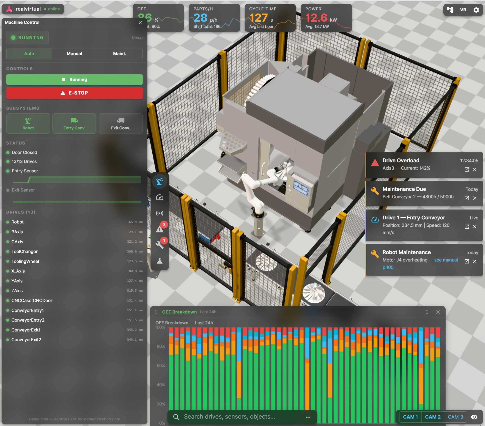
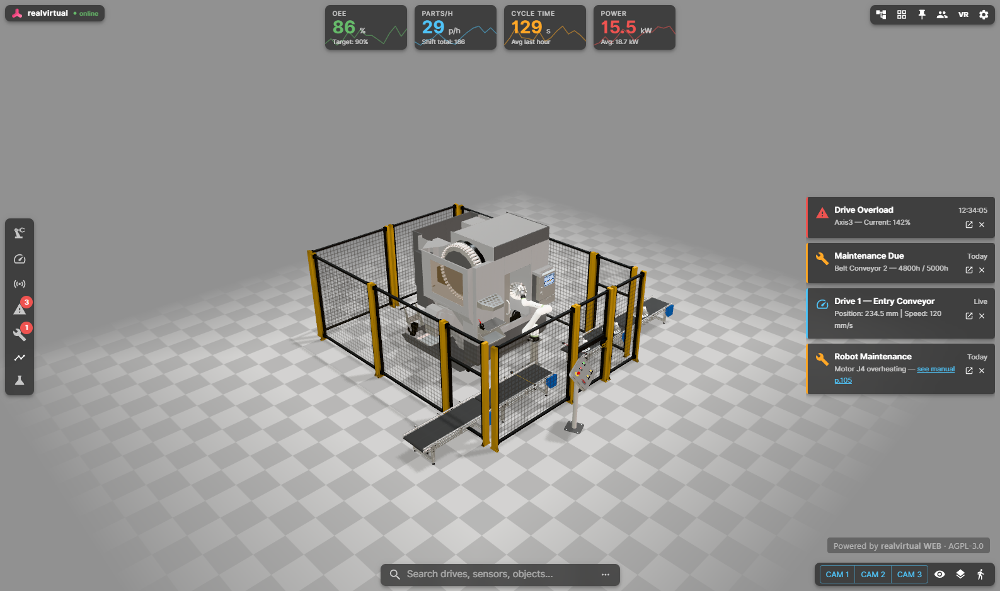
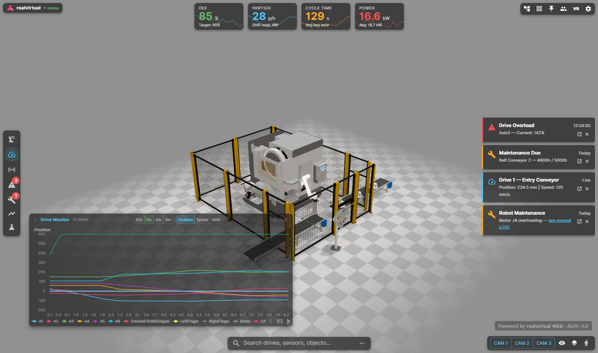
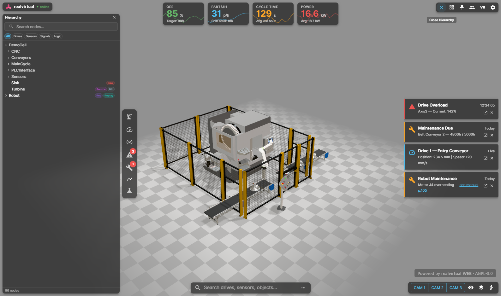
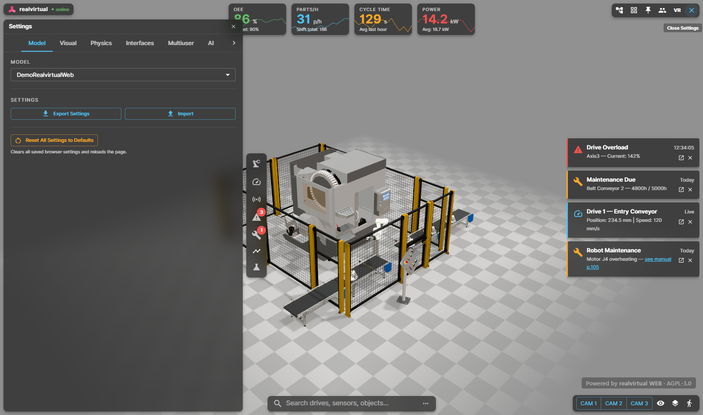

# realvirtual

**The browser platform for industrial digital twins — 3D HMI, virtual commissioning, Machine Information System, simulation and layout planning**

[](https://www.gnu.org/licenses/agpl-3.0)
[](https://www.typescriptlang.org/)
[](https://threejs.org/)
[](doc-ai-integration.md)



realvirtual (formerly *realvirtual WEB*) is an open-source, browser-based 3D HMI and digital twin platform for manufacturing. Open GLB/glTF models in the browser, simulate drives and material flow, connect real or simulated PLCs for virtual commissioning, and build operator dashboards. Simulation components use `rv_extras` metadata, which you can export from [realvirtual for Unity](https://realvirtual.io) Professional or author with your own tools. Viewers need no desktop installation; developers can build the Community application with Node.js.

**One link. Any device. Live Digital Twin.** Try it: [web.realvirtual.io/demo](https://web.realvirtual.io/demo)

This repository is the **Community edition** under AGPL. It includes the viewer, HMI, transport simulation, layout planner and the discrete event simulation (DES) core with run statistics. The DES experiment manager (variants, replications, confidence intervals, batch runs) is a commercial module. Browser asset authoring, CAD import and additional simulation modules are commercial extensions. See [Community Edition vs. Commercial](#community-edition-vs-commercial).

> Made by [realvirtual GmbH](https://realvirtual.io). realvirtual runs in the browser; [realvirtual for Unity](https://realvirtual.io) — a [Unity Verified Solution](https://unity.com/partners/realvirtual) — is the option for Unity developers and native builds.

## What It Does

realvirtual replaces traditional desktop HMI and SCADA visualization with a modern, browser-based 3D experience. Connect real PLCs and robot controllers through [realvirtual CONNECT](#industrial-connectivity), and operators see live machine states — drive positions, sensor readings, alarms, KPIs — all in the context of the machine's 3D layout. Unlike flat panel HMIs, operators see *what* is happening, *where* it is happening, and *why*.

### Key Capabilities

- **Workspace Modes** — Viewer for presentation, HMI for operation, Planner for layouts, and Commissioning for commissioning workflows. The DES core (event-driven simulation, fast forward, statistics, snapshots, scripting) is included in Community; the Editor and the DES experiment manager are commercial modules. Select a workspace from the toolbar or use `?mode=viewer`, `hmi`, `planner`, `commissioning`, `des` or `editor`; selecting a mode does not install its required features.
- **Live 3D HMI** — Real-time PLC signal visualization. Machines connect through realvirtual CONNECT — Siemens S7, TwinCAT ADS, OPC UA, EtherNet/IP, Modbus, MQTT, ctrlX, robot controllers and more. Drive monitoring, sensor states, KPI overlays, alarm dashboards, and production charts powered by [Apache ECharts](https://echarts.apache.org/).
- **Virtual Commissioning** — Test PLC programs against the digital twin before the machine exists. Connect a real or simulated controller (e.g. Siemens PLCSIM Advanced, SIMIT, TwinCAT) through realvirtual CONNECT, link signals to drives and sensors, force and monitor signals, and jog axes in the dedicated Commissioning workspace — all in the browser.
- **Signal Linking by Drag & Drop** — Drag a live interface signal straight onto a component slot (Forward, TargetSpeed, SensorOccupied, …). Direction and value type are checked, connections are saved with the layout, and signals can be monitored and forced.
- **Collision Detection** — Give a node one of six collision roles (Tool, Workpiece, Machine, Robot, Environment, None); while the simulation runs, every pair of bodies with *different* roles is checked against each other.
- **Machine Information System** — Attach documents, maintenance guides, technical drawings, and manuals directly to 3D components. Technicians click a part and see its documentation in context — accessible from any device on the shop floor.
- **Transport Simulation** — Full in-browser simulation engine at 60 Hz fixed timestep: conveyor surfaces, sources, sinks, sensors with AABB collision, grippers, and material flow.
- **LogicStep Sequencing** — Serial/parallel containers, signal conditions, delays, drive commands — ported from realvirtual for Unity Professional.
- **WebXR (VR/AR)** — Immersive visualization in compatible WebXR browsers and devices. VR, AR and surface detection depend on browser and device capabilities.
- **Layout Planning** — Assemble factory layouts directly in the browser: drag reusable parts from a library onto a grid, connect them with typed snap points, and position them with transform gizmos. Ships with a standard parts library and can load any GLB catalog straight from a GitHub repository.
- **Multiuser Sessions** *(Beta)* — Real-time collaboration with avatars, shared camera views, role management, and late-join state sync.
- **Plugin Architecture** — Extend with custom plugins for project-specific HMI, KPI dashboards, maintenance workflows, and industrial interfaces.
- **AI-Ready (MCP)** — Let an AI assistant inspect drives, read and write signals, query the scene and debug simulation through the browser MCP bridge. Connect through the separately installed realvirtual CONNECT gateway or the Node development fallback; see [AI setup](doc-ai-integration.md).

## Community Edition vs. Commercial

This repository is the **community edition** of realvirtual. It contains the complete viewer and HMI runtime under AGPL-3.0 and builds and runs entirely on its own — the commercial extension modules resolve to no-op stubs (`src/private-stubs/`), so the corresponding features are simply absent from a public build.

<!-- editions:begin -->
<!-- Generated from features.catalog.json and the tier manifest by `npm run features:generate -- --write-readme`. Do not edit by hand. -->

| Feature | Community (AGPL) | Commercial | Public demo |
| --- | --- | --- | --- |
| **Visualize & HMI** | | | |
| [3D viewer and HMI (GLB with rv_extras, panels, overlays, camera views, PDF links, machine information)](https://realvirtual.io/doc/web/hmi/overview/) | Included | Included | Included · [Try it](https://web.realvirtual.io/demo/?doc=doc_demorealvirtualweb_7l7hfw&mode=hmi) |
| WebXR (VR/AR in the browser) | Included | Included | Included |
| [Cinematic rendering and video recording](https://realvirtual.io/doc/web/getting-started/viewer/cinematic-videos/) | — | Included | Included |
| Virtual camera displays | — | Included | Included |
| [Stereo 3D](https://realvirtual.io/doc/web/immersive/stereo-3d/) *(Beta)* | — | Included | Included |
| [Display walls](https://realvirtual.io/doc/web/immersive/display-wall/) *(Beta)* | — | Included | Included |
| [Flystick control](https://realvirtual.io/doc/web/immersive/display-wall/#use-flysticks) *(Beta)* | — | Included | Included |
| [Guided maintenance (the machine follows the steps)](https://realvirtual.io/doc/web/hmi/guided-maintenance/) | — | Included | Included |
| **Simulate** | | | |
| [Transport simulation (drives, sensors, conveyors, sources/sinks, grippers, LogicSteps)](https://realvirtual.io/doc/web/components/material-flow/) | Included | Included | Included |
| [Collision detection](https://realvirtual.io/doc/web/components/collision-detection/) | Included | Included | Included |
| Smooth drive motion | — | Included | Included |
| [Physics](https://realvirtual.io/doc/web/components/physics/) *(Beta)* | — | Included | Included |
| [Detail physics (MuJoCo)](https://realvirtual.io/doc/web/components/detail-physics/) *(Beta)* | — | Included | Included · [Try it](https://web.realvirtual.io/demo/?doc=doc_mujocowalker_15i4u8p&mode=commissioning) |
| [Discrete event simulation](https://realvirtual.io/doc/web/des/overview/) | Included | Included | Included · [Try it](https://web.realvirtual.io/demo/?doc=doc_test-des-turntable-loop_1y3v7m0&mode=des) |
| [DES experiment manager](https://realvirtual.io/doc/web/des/experiments/) | — | Included | Included · [Try it](https://web.realvirtual.io/demo/?doc=doc_palletyard_hzmdb6&mode=des) |
| [Machining simulation](https://realvirtual.io/doc/web/components/machining/) *(Beta)* | — | Included | Included |
| [Virtual PLC (Structured Text in the browser)](https://realvirtual.io/doc/web/components/virtual-plc/) | — | Included | Included · [Try it](https://web.realvirtual.io/demo/?doc=doc_laserweldingassemblystation_1n66y05&mode=commissioning) |
| **Build the twin** | | | |
| [Layout planner](https://realvirtual.io/doc/web/planner/overview/) | Included | Included | Included · [Try it](https://web.realvirtual.io/demo/?doc=doc_demoplanner_gf4m6v&mode=planner) |
| [Asset and kinematics editor](https://realvirtual.io/doc/web/editor/overview/) | — | Included | Included |
| [CAD import (STEP, JT, USD, FBX, Onshape, Unity Asset Manager)](https://realvirtual.io/doc/web/editor/importing/) | — | Included | Included |
| Robot inverse kinematics *(Beta)* | — | Included | Included |
| [Kinematic mechanisms (cranks, couplers, parallel kinematics)](https://realvirtual.io/doc/web/components/mechanism/) | — | Included | Included · [Try it](https://web.realvirtual.io/demo/?doc=doc_autonox-delta-rl5-1900-6kg_torq7x&mode=commissioning) |
| **Connect** | | | |
| [Signals and PLC connectivity (WebSocket, MQTT, ctrlX, REST; drag-and-drop signal linking)](https://realvirtual.io/doc/web/commissioning/connect-a-plc/) | Included | Included | Included |
| [Multiuser sessions](https://realvirtual.io/doc/web/getting-started/multi-user-sessions/) *(Beta)* | Included | Included | Included |
| **Industrial interfaces (realvirtual CONNECT)** | | | |
| [Siemens (S7, PLCSIM Advanced)](https://realvirtual.io/doc/web/connect/interfaces/protocols/#siemens-s7) | Free tier: 20 signals | Unlimited\* | Free tier: 20 signals |
| [OPC UA, MQTT, Modbus TCP (client and server)](https://realvirtual.io/doc/web/connect/interfaces/protocols/) | Free tier: 20 signals | Unlimited\* | Free tier: 20 signals |
| [Controllers (Beckhoff TwinCAT ADS, EtherNet/IP for Allen-Bradley and Omron, B&R PVI, Mitsubishi MELSEC, Keba, Festo AX / PLCnext, Bosch Rexroth ctrlX)](https://realvirtual.io/doc/web/connect/interfaces/protocols/) | Free tier: 20 signals | Unlimited\* | Free tier: 20 signals |
| [Robots (FANUC, KUKA, ABB, Universal Robots, Denso, igus, RoboDK, Wandelbots NOVA)](https://realvirtual.io/doc/web/connect/interfaces/protocols/) | Free tier: 20 signals | Unlimited\* | Free tier: 20 signals |
| [Simulation and custom couplings (SIMIT, WINMOD, shared memory, UDP telegrams, WebSocket Realtime)](https://realvirtual.io/doc/web/connect/interfaces/protocols/) | Free tier: 20 signals | Unlimited\* | Free tier: 20 signals |
| [CAD conversion (STEP, JT)](https://realvirtual.io/doc/web/connect/services/cad-conversion/) | Not included (CAD import is part of the editor) | Unlimited\* | Free tier: 25 MB STEP / 12 MB JT |
| **Integrate** | | | |
| [Plugin system and MCP bridge for AI assistants](https://realvirtual.io/doc/web/connect/development/ai-bridge/) | Included | Included | Included |
| [USD live link to NVIDIA Isaac Sim (incl. Kit extension)](https://realvirtual.io/doc/web/physical-ai/isaac-sim-live-link/) | Included | Included | Included |
| [USD export](https://realvirtual.io/doc/web/physical-ai/isaac-sim-live-link/) | — | Included | Included |

**Industrial interfaces (realvirtual CONNECT):** \* with a realvirtual CONNECT licence (annual or lifetime) or a licensed realvirtual site. Every tier supports every protocol.

**Community (AGPL)** is this repository. **Commercial** adds the modules marked "—" in the Community (AGPL) column; they are not part of this repository, and a public build resolves them to no-op stubs. The DES experiment manager is a commercial module. *(Beta)* marks features that are usable but still changing.

**Public demo:** [web.realvirtual.io/demo](https://web.realvirtual.io/demo) runs every Community (AGPL) and Commercial feature and is free to use for evaluation and non-commercial purposes. Compared with Commercial, it runs on the free tier of realvirtual CONNECT (20 signals, STEP files up to 25 MB, JT files up to 12 MB), comes without source code, cannot be extended with your own plugins, and is provided as is, without support or warranty. A local Community (AGPL) build does not gain the Commercial modules by opening the same model.
<!-- editions:end -->

Two related commercial products complete the platform and are separate from this repository:

- **[realvirtual for Unity — Professional](https://realvirtual.io)** — the Unity runtime for Unity developers and native builds (.exe, Linux, XR); it exports `rv_extras`-enriched GLBs and bridges 15+ native industrial protocols (Siemens S7, Beckhoff ADS, OPC UA, and more).
- **[realvirtual CONNECT](https://realvirtual.io/doc/web/connect/overview/)** — the gateway that makes Live mode work (industrial protocols → WebSocket) and hosts the built-in MCP server.

A commercial license additionally allows proprietary/closed-source use, keeping your own plugins and extensions confidential when you deliver, and the right to remove or replace the attribution notice — see [License](#license).

## Use Cases

### 3D HMI / Operator Dashboards
Web-based HMI connected to real PLCs through realvirtual CONNECT. Live signal visualization, KPI overlays, drive monitoring — replacing desktop HMI applications with a browser link.



### Machine Information System
Attach PDFs, maintenance guides, technical drawings, operating manuals, and spare part lists directly to individual 3D components. Technicians open a link on their tablet, click on a motor or valve, and immediately see its documentation, maintenance history, and real-time status — all in 3D context, on-site or remotely. No more searching through binders or file shares.

### Sales & Product Presentation
Interactive 3D models that let prospects explore machines live in the browser. More convincing than slides, more accessible than installed software. Share a link — done.

### Product Configurators
Build browser-based 3D product configurators where customers select options, variants, and accessories — and see the result rendered in real time. Combine with the plugin system to add pricing, BOM generation, or quote workflows.

### Layout Planning
Assemble factory layouts directly in the browser — drag conveyors, robots, fixtures, and pallets from a parts library onto a grid, connect them with typed snap points, and arrange them with transform gizmos. Ships with a standard parts library, and can additionally load GLB catalogs from a URL or GitHub repository.


**Try it live:** Open the [public demo](https://web.realvirtual.io/demo) and choose **Layout planning** on the welcome screen.

### Virtual Commissioning
Validate PLC code against the simulated machine instead of on the shop floor. Connect the controller — real hardware or a virtual PLC such as Siemens PLCSIM Advanced — through realvirtual CONNECT and open the model in the **Commissioning** workspace (`?mode=commissioning`): link interface signals to drives and sensors by drag & drop, force and monitor signals, test axes, and run the transport simulation against the live PLC. Because the twin runs in the browser, automation engineers, integrators and customers can commission together from anywhere — no Unity or desktop installation required.

### Training & Onboarding
Operators learn machine behavior interactively before touching the real system. No software installation, no VPN, no IT department required.

### Remote Acceptance & Support
Share virtual commissioning models with customers for review and sign-off — worldwide, instantly.

## Quick Start

Follow the [complete Community walkthrough](doc-getting-started.md) for project saving, reopening and self-hosting.

To put a project online — on the CDN zone realvirtual provisioned for you, on your own Bunny account, or on any static host — see **[Publishing a project](doc-publishing.md)** (`npm run publish:project -- --list` to start).

```bash
# Use Node.js 22 or 24 LTS
# Clone the standalone Community repository
git clone https://github.com/game4automation/realvirtual-WEB.git
cd realvirtual-WEB

npm ci
npm run dev          # Vite dev server with HMR
```

Load your own model in one of three ways — there is no folder that gets scanned:

- **Import it in the app** — open the import dialog and choose the **GLB File** tab, then drop `.glb` files or pick them from disk. Files stay in your browser; nothing is uploaded.
- **Link to it** — `?glb=https://host/your-model.glb` loads a GLB from any host you control (GitHub raw, a CDN, your own server). Nothing is uploaded and no sign-in is needed.
- **Put it in a project** — a project declares what it holds in its own `project.json` (`documents[]`), and that manifest is the single source of truth. The bundled demo in `public/demo-realvirtual/` is a working example. This is the path a delivered project uses: it keeps its documents in the project itself (root-level, `models/`, `library/` — the folder is a place, not a type).

```bash
npm run build        # Production build -> dist/ (local only, nothing published)
npm run preview      # Preview production build
npx tsc --noEmit     # Type check (community view)
npx playwright install chromium  # Install the browser before browser tests
npm test             # Run browser tests (headless Chromium via Playwright)
npm run test:node    # Run Node.js tests (fs, glob, ESLint instance)
npm run test:all     # Run both Node + browser tests
npm run build:embed  # Build the embed app required by the E2E preview server
npm run e2e          # Run Playwright end-to-end tests (e2e/)
npm run lint         # ESLint (flat-config, boundaries rule)
```

**Type checking:** plain `npx tsc --noEmit` is the **community view** — the base `tsconfig.json`
excludes the generated list of private-dependent tests (`tests/private-dependent-tests.json`), so it
type-checks exactly what a clone of this repository actually contains. `npm run typecheck` is the
*maintainer* full check: it uses `tsconfig.full.json` and **requires the private sibling repository**
`../realvirtual-WebViewer-Private~`, which is not part of this repository — running it without that
folder produces a wall of unresolvable `@rv-private/*` errors. Use `npx tsc --noEmit`.

Publishing is maintainer-only: `npm run deploy` uploads to realvirtual's own Bunny CDN
(`web.realvirtual.io`) and needs `BUNNY_*` credentials that ship with no clone. To host a build
yourself, serve the `dist/` folder produced by `npm run build` from any static web server — see
[doc-deploy.md](doc-deploy.md) for the deployment details.

## Operating Modes

| Mode | Description |
|------|-------------|
| **Standalone** | Pure browser simulation — no gateway, no PLC. The fixed-timestep simulation loop runs the full digital twin offline. |
| **Live** | Connected to a **realvirtual CONNECT** gateway over WebSocket — CONNECT talks to the PLC and streams signals into the browser in real time. This is the usual arrangement for PLC protocols (OPC UA, S7, ADS, Modbus, …), because the browser cannot speak them directly. |
| **Direct** | The browser connects straight to the equipment over a browser-capable protocol (MQTT over WebSocket, REST) — no gateway in the loop. |

**realvirtual CONNECT** is the gateway that makes Live mode work: it speaks the industrial
protocols a browser cannot, and hands the signals to the browser over one WebSocket. It is a
separate product and is documented at
[realvirtual.io/doc/web/connect](https://realvirtual.io/doc/web/connect/overview/) — this repository holds
only the browser side of the contract (see [doc-webviewer-interface.md](doc-webviewer-interface.md)).

## Deployment Options

- **Self-hosted application** — Build with `npm run build` and serve `dist/` from your own static host. See [hosting and deployment](doc-deploy.md).
- **Embedded viewer** — Build with `npm run build:embed` and integrate the custom element or lightweight viewer API into your site. See [embedding](doc-embedding.md).
- **Project delivery** — Keep `project.json`, models, attachments and compiled plugins together. See [projects and saving](doc-projects.md).
- **Kiosk display** — Hide configuration controls for shop-floor panels. Configure access restrictions on your hosting infrastructure; a hidden control or an unguessable link is not authentication.

Publishing to realvirtual's hosted demo uses maintainer credentials and infrastructure.

## Tech Stack

| Component | Technology |
|-----------|-----------|
| 3D Rendering | [Three.js](https://threejs.org/) (WebGL + WebGPU *(Beta)* + WebXR) |
| UI Framework | React 19 + MUI 7 |
| Charts | Apache ECharts 6 |
| Build Tool | Vite 6 |
| Language | TypeScript 5.9 |
| Testing | Vitest (browser-mode) + Playwright |

## Industrial Connectivity

**Machines connect through [realvirtual CONNECT](https://realvirtual.io/en/products/connect).** CONNECT is a native gateway that runs next to the machine (IPC or edge PC). It speaks the controllers' own protocols and streams every signal into the browser over one WebSocket (the openly documented WebSocket Realtime v2 protocol). Interfaces are configured and monitored in the browser, signal by signal. The free CONNECT tier covers all interfaces with up to 20 signals.

| Category | Interfaces in realvirtual CONNECT |
|----------|-----------------------------------|
| **PLCs** | Siemens S7 (S7-300/400/1200/1500) · Siemens PLCSIM Advanced (native API) · Beckhoff TwinCAT ADS · OPC UA · EtherNet/IP (Allen-Bradley, Omron) · Modbus TCP client and server · Bosch Rexroth ctrlX (native Data Layer or bridge) · Keba Kemro X · Festo AX / Phoenix Contact PLCnext |
| **IoT** | MQTT — topics, Siemens process image, flat JSON (SEW MOVI-C) |
| **Robots** | FANUC (RoboGuide / Robot-IF) · Denso (b-CAP / WinCaps VRC) · ABB RobotStudio |
| **Simulation** | Siemens SIMIT (shared memory) |

Full list with addressing and settings: [CONNECT interfaces](https://realvirtual.io/doc/web/connect/interfaces/protocols/).

**Without a gateway**, the browser can also connect directly to equipment that speaks a browser-capable protocol:

| Interface | Description |
|-----------|-------------|
| **WebSocket Realtime v2** | Your own bridge or server speaking the open realvirtual protocol |
| **MQTT over WebSocket** | Brokers that offer a WebSocket listener |
| **REST API** | Polling-based signal access |

[realvirtual for Unity](https://realvirtual.io) Professional has its own 25+ interfaces that run inside Unity — no separate gateway is needed there.

## Architecture

realvirtual loads GLB/glTF geometry from compatible exporters. Project setup and loading options are covered in [Getting started](doc-getting-started.md).

The GLB stores model geometry and `rv_extras` metadata such as signal bindings, drives and sensors. The project manifest (`project.json`) identifies documents and their plugin bindings; attachments and compiled project plugins can be separate files. Keep these together when delivering a project. [realvirtual for Unity](https://realvirtual.io) Professional can export enriched GLBs, and the metadata format is also documented for other toolchains.

```
src/
  core/
    engine/          # Simulation engine (drives, sensors, transport)
    hmi/             # React HMI components (panels, tooltips, settings)
  hooks/             # React hooks
  interfaces/        # Industrial protocol adapters (WebSocket, MQTT, ctrlX)
  plugins/           # Built-in plugins (multiuser, annotations, FPV, XR)
    demo/            # Demo charts and HMI (OEE, cycle time, energy, drive/sensor overlays)
    models/          # Built-in model plugin packs compiled into the application
  private-stubs/     # No-op stubs for commercial modules — what makes this community
                     #   edition build and run without the private sibling repository
  embed/             # Lightweight embedding entry points
examples/community-first-project/  # Portable project with a TypeScript plugin
tests/               # Vitest browser and Node tests
e2e/                 # Playwright E2E tests
public/demo-realvirtual/  # Bundled demo project: its GLBs and its project.json manifest
```

## Extending realvirtual

Plugins can contribute UI components to predefined **slots** in the HMI layout — KPI bar, button panel, message panel, settings tabs, and more. The built-in demo plugin uses all of these:







For a project-specific extension, start with the [runnable Community plugin example](doc-project-plugin-example.md). It binds a TypeScript module to a document through `documents[].scriptRef` in the project manifest:

```json
{
  "id": "doc_triangle_dkqhmg",
  "name": "Community triangle",
  "path": "triangle.glb",
  "scriptRef": "plugins/counter.ts"
}
```

Prepare and compile the example from the repository root:

```bash
node examples/community-first-project/prepare.mjs
npm run build:project-scripts -- examples/community-first-project
```

Open the project folder in the application and allow its native project code after reviewing it. The [counter plugin](examples/community-first-project/plugins/counter.ts) exports paired `registerModelPlugins` and `unregisterModelPlugins` functions. It demonstrates `viewer.use()`, signal subscriptions, and cleanup on model close, plugin disable and disposal. Distribute the compiled `.js` alongside the `.ts` source and manifest.

Built-in model plugin packs under `src/plugins/models/` are compiled into the application. Use project `scriptRef` bindings for extensions that should travel with a project. For JavaScript behaviors stored inside a GLB, see [Component Scripting](doc-scripting.md).

For the full plugin API — UI slots, event bus, hooks, context menus, and tooltip extensions — see [doc-extending-webviewer.md](doc-extending-webviewer.md).

## Documentation

End users start at the **[realvirtual documentation site](https://realvirtual.io/doc/web/)**.
For this Community checkout, start with **[Getting started](doc-getting-started.md)**, then the **[project plugin example](doc-project-plugin-example.md)** or **[Architecture](doc-webviewer.md)**. The full in-repo documentation set:

**Getting started & architecture**

| Document | Contents |
|----------|----------|
| [Architecture](doc-webviewer.md) | Full architecture, component reference, configuration, workspace modes |
| [Getting started](doc-getting-started.md) | Standalone Community install, first project, build and hosting |
| [Projects and saving](doc-projects.md) | Documents, save/autosave, recovery and moving projects |
| [Publishing a project](doc-publishing.md) | Put a project on a CDN zone: realvirtual-hosted, your own Bunny account, or any static host |
| [Project plugin example](doc-project-plugin-example.md) | Runnable public scriptRef project with cleanup |
| [Embedding](doc-embedding.md) | Custom element and direct lightweight viewer API |
| [Migration](doc-migration.md) | Move older projects to current contracts |
| [AGV and fleet control](doc-path-fleet-control.md) | Paths, tasks, docking and project control |
| [Virtual PLC (commercial beta)](doc-plc-programming.md) | Requires an enabled commercial build; not in Community |
| [From Unity to the Web](doc-unity-to-web.md) | Porting patterns and the AI coding-agent workflow |
| [Lifecycle](doc-lifecycle.md) | Runtime lifecycle: model load, fixed-step loop, pause, reset, dispose, events |
| [Node Paths](doc-node-paths.md) | How component, signal and kinematic references are written and resolved |

**Building & extending**

| Document | Contents |
|----------|----------|
| [Plugin Development](doc-extending-webviewer.md) | Plugin system, custom components, UI slots, hooks |
| [Entity stream](doc-entity-stream.md) | Objects moved by an external simulation: telegram in, smooth instanced motion out |
| [Events & Hooks](doc-events-and-hooks.md) | Typed event bus and plugin/component lifecycle hooks |
| [Component Behaviors](doc-behaviors.md) | Per-node TypeScript behaviors and naming conventions |
| [Component Scripting](doc-scripting.md) | JavaScript behaviors authored inside the GLB, run in a QuickJS sandbox |
| [Behavior Modelling](doc-behavior-modelling.md) | Continuous vs DES material-flow modelling (beginner's guide) |
| [Signal Architecture](doc-signal-architecture.md) | Signal store: GLB import to React UI, PLC direction, batching |
| [Signal Connection Logic](doc-signal-connection-logic.md) | Slots, connection states, drag & drop linking, forcing, persistence |
| [UI Visibility](doc-ui-visibility.md) | Which axis decides what is shown: plugin modes vs. UI visibility rules |

**Authoring & operations**

| Document | Contents |
|----------|----------|
| [Layout Planner](doc-layout-planner.md) | Library objects, catalogs, snap points, pivots, deep-links |
| [Persistence](doc-persistence.md) | Document model, GLB drafts, autosave, recovery and storage backends |
| [Document Linking](doc-document-linking.md) | PDF/AASX datasheet linking and metadata |

**Connectivity & collaboration**

| Document | Contents |
|----------|----------|
| [Industrial Interfaces](doc-webviewer-interface.md) | WebSocket Realtime, ctrlX, MQTT, signal flow, new-interface guide |
| [Multiuser System](doc-multiuser-system.md) | Sessions, shared views, avatars |
| [AI Integration](doc-ai-integration.md) | AI integration and the MCP bridge |
| [MCP Tools](webviewer.mcp.md) | MCP tools reference (read state, set signals, build layouts) |

**Deploy & debug**

| Document | Contents |
|----------|----------|
| [Building & Deploying](doc-deploy.md) | Community self-hosting and separate maintainer publishing workflows |
| [Debugging Guide](doc-web-debugging.md) | Debugging tools, debug API, E2E tests, workflow |

## Documentation checks

Run `npm run docs:generate` after changing `ViewerEvents`, then `npm run docs:check`.
The check validates the working tree, including new untracked files. Before publishing,
run `node scripts/assert-docs-publishable.mjs` after adding the intended files to Git;
its default mode validates the tracked mirror payload.

## AI-Enabled Development (MCP)

realvirtual and realvirtual for Unity are fully AI-enabled through the **Model Context Protocol (MCP)**. AI coding assistants like [Claude Code](https://claude.ai/code) can drive the running scene directly.

**[realvirtual CONNECT](https://realvirtual.io/doc/web/connect/overview/) is a separate installation** and the default MCP host. Once installed and configured, it exposes `http://localhost:5100/mcp`; the browser bridge connects to CONNECT to make the `web_*` tools available. A local Node bridge is also supported for development. Follow [AI Integration](doc-ai-integration.md) for setup, registration requirements and troubleshooting.

- **realvirtual (browser)** — list drives and positions, read/write PLC signals, query the scene
  hierarchy, inspect sensor states, debug transport simulation, take screenshots of the running
  scene.
- **Unity Editor** *(optional)* — with [realvirtual for Unity](https://realvirtual.io) Professional, the
  separate realvirtual MCP package adds 80+ editor tools: create GameObjects, set component
  properties, run simulations, manage scenes, run tests.

This means AI assistants can design, build, test, and debug industrial digital twins end-to-end.

### Getting Started with AI Development

This repo includes guidance for AI coding assistants such as [Claude Code](https://claude.ai/code):

- **[CLAUDE.md](CLAUDE.md)** — Project conventions, architecture overview, and coding guidelines for AI assistants
- **[webviewer.mcp.md](webviewer.mcp.md)** — MCP tools reference for browser-side scene inspection

Open this project in Claude Code, start the dev server and connect the MCP bridge as described in [AI Integration](doc-ai-integration.md) — then inspect drives, signals and the scene through natural language.

## One Platform, Two Runtimes

realvirtual is the browser platform and the default way to work. Both runtimes share the same data — GLB files with `rv_extras` — and connect to machines through realvirtual CONNECT.

| | realvirtual (browser) | realvirtual for Unity |
|---|---|---|
| **For** | Drag & drop users and everyone building 3D HMIs, Machine Information Systems or their own web apps | Unity developers and teams that need native builds |
| **Scope** | 3D HMI, virtual commissioning, Machine Information System, simulation, DES, layout planning, collaboration; commercial asset authoring and CAD import | Engineering in the Unity Editor, virtual commissioning, native protocol drivers |
| **Technology** | Three.js, TypeScript, React | Unity Engine, C# |
| **Deployment** | Any modern browser | Desktop (.exe, Linux), XR headsets, mobile |
| **PLC connection** | realvirtual CONNECT gateway, or direct WebSocket, MQTT over WebSocket and REST | Native protocol drivers |

## Contributing

Contributions are welcome. Please note that realvirtual is **dual-licensed**
(AGPL-3.0-only + commercial): by submitting a pull request or any other
contribution, you agree to the grant of rights described in
[CONTRIBUTING.md](CONTRIBUTING.md), which allows realvirtual GmbH to also
license your contribution under its commercial license.

## License

Copyright (C) 2025–2026 [realvirtual GmbH](https://realvirtual.io)

This program is licensed under the **GNU Affero General Public License v3 (AGPL-3.0)**.

**What this means:** Using realvirtual yourself is free, also commercially. If you change it and let others use the changed version over a network, also colleagues, offer them its source (AGPL section 13). The obligations start when you deliver realvirtual to other people (your own hosted link, a delivery package, an offline installation): everyone who receives it must be able to get the complete source of the delivered software under AGPL-3.0 — realvirtual with your changes, tightly coupled plugins and HMI components, and embedded scripts that take over core code. For a public link that is every visitor. You do not have to publish it to the world, but recipients may pass it on, and you may not forbid that.

**Your model data stays yours.** Geometry, layout, parameters and the metadata of a GLB are your own data; AGPL does not require you to disclose them, also not when you deliver them with realvirtual. Handing over only a GLB file usually triggers nothing.

**The attribution notice stays.** Every AGPL build shows "Powered by realvirtual WEB · AGPL-3.0" with a link to the source. Keeping it reasonably visible and legible is an additional term under AGPL section 7(b), see [NOTICE.md](NOTICE.md). You may adapt its position, size and style; you may not remove it, cover it or make it illegible.

**When you need a commercial license:** removing the notice or replacing it with your own brand; the commercial modules (Editor, CAD import, …) in your own deployment; keeping plugins or extensions confidential in a delivery whose source you would otherwise have to provide. Offline delivery, your own plugins and your own brand next to the notice are possible under AGPL as long as you meet its obligations. Details and our reading of borderline cases: [Licensing the viewer](https://realvirtual.io/doc/web/hosting/licensing/).

See [LICENSE](LICENSE) for the full license text and [NOTICE.md](NOTICE.md) for the additional terms. The 3D models and library components are covered by [CONTENT-LICENSE.md](CONTENT-LICENSE.md); files listed in [CONTENT-MANIFEST.md](CONTENT-MANIFEST.md) that were published before 2026-11-02 remain available under AGPL-3.0 as well.

**SPDX-License-Identifier:** `AGPL-3.0-only`

### Third-party components

realvirtual WEB includes third-party software and content that is **not** covered by the
AGPL-3.0 and remains under its own licence or terms:

- **npm dependencies and bundled assets** — every build writes `THIRD-PARTY-NOTICES.txt`
  (and `third-party-notices.json`) next to `index.html`, listing each shipped component with
  its licence, copyright and source. The inventory and licence policy live in `third-party/`.
- **Demo content provided by third parties** — for example
  `public/pdf/fanuc-crx-educational-cell-manual.pdf` (FANUC). It is included for demonstration
  purposes only, remains the property of its owner and may not be reused outside this demo.
- `public/pdf.worker.min.js` — pdf.js, Mozilla, Apache-2.0.
- `public/envmaps/empty_warehouse_01_1k.hdr` — Poly Haven, CC0-1.0.

### Commercial License

If you want to use realvirtual in proprietary or closed-source products — or keep your own plugins and extensions confidential when you deliver — a commercial license is available.

Contact: [realvirtual.io/en/company/license](https://realvirtual.io/en/company/license)

---

**[realvirtual.io](https://realvirtual.io)** | [Live Demo](https://web.realvirtual.io/demo) | [realvirtual Documentation](https://realvirtual.io/doc/web/) | [realvirtual for Unity Documentation](https://doc.realvirtual.io) | [YouTube](https://youtube.com/@realvirtualio) | [Forum](https://forum.realvirtual.io)
